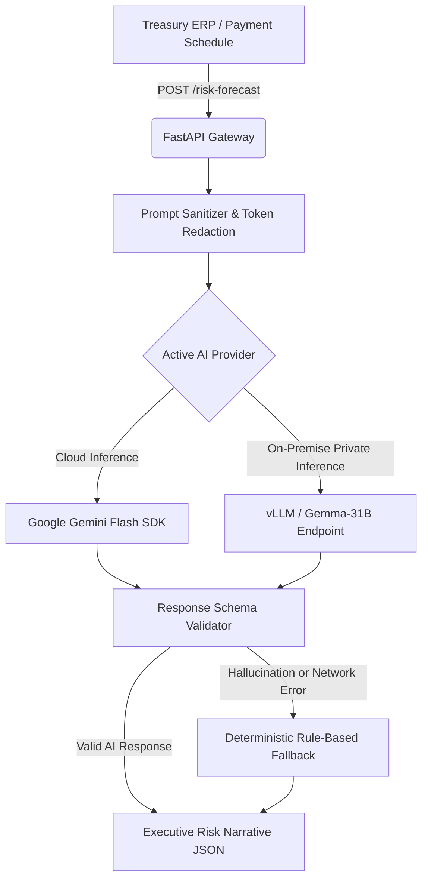

# 💼 UzAssets Treasury Risk AI · Payment Calendar Risk Analytics Engine

[](https://python.org)
[](https://fastapi.tiangolo.com)
[](https://ai.google.dev)
[](https://vllm.ai)
[](LICENSE)
[]()

> **Enterprise Context:** **«UzAssets» Investment Company AJ** is Uzbekistan's premier state-owned asset management and investment enterprise, driving transformation, privatization, and capital market readiness across major national industrial entities.

This microservice powers the **UzAssets Treasury Payment Calendar**, providing real-time cash flow risk forecasting, overdue payment bottleneck analysis, and generative multi-lingual **Executive Risk Narratives** for financial directors and enterprise executives.

---

## 📑 Table of Contents
- [Executive Overview](#-executive-overview)
- [Key Risk Drivers](#-key-risk-drivers)
- [System Architecture](#-system-architecture)
- [Deterministic Fallback Engine](#-deterministic-fallback-engine)
- [API Endpoints](#-api-endpoints)
- [Installation & Quickstart](#-installation--quickstart)
- [Contact](#-contact)

---

## 🎯 Executive Overview

Managing treasury schedules across multi-enterprise conglomerates involves high financial volatility:
* Unbalanced cash flows causing temporary liquidity gaps;
* Imminent debt service deadlines and FX currency exposure;
* Administrative approval bottlenecks delaying mission-critical vendor disbursements.

This system evaluates tabular payment schedules, computes risk scores across multiple dimensions, and synthesizes clear, actionable executive summaries with prioritized operational recommendations in **English, Uzbek, and Russian**.

---

## ⚡ Key Risk Drivers

The engine evaluates and isolates 6 fundamental treasury risk vectors:
1. `PAYMENT_CONCENTRATION`: High-volume outflows clustered on a single settlement date.
2. `OVERDUE_PRESSURE`: Immediate default risk and penalty exposure from overdue obligations.
3. `APPROVAL_BOTTLENECK`: Disbursements stalled in hierarchical administrative approval workflows.
4. `BUDGET_LIMIT_STRESS`: Spending requests exceeding allocated organizational budget limits.
5. `CURRENCY_EXPOSURE`: Exchange rate volatility risk on foreign currency denominated obligations.
6. `DEBT_SERVICE_STRESS`: Senior loan interest and amortization payments dominating total liquidity.

---

## 🏗 System Architecture



---

## 🛡 Deterministic Fallback Engine

Financial systems require 100% uptime guarantees. If the upstream LLM provider is unreachable, throttled, or fails validation, the built-in **Rule-Based Fallback Generator** (`narrative_fallback.py`) automatically synthesizes mathematically grounded executive narratives and recommendations directly from input telemetry without failing the HTTP request.

---

## 🚀 API Endpoints

Swagger UI is accessible at: `http://localhost:8002/docs`

| Method | Endpoint | Description |
|---|---|---|
| `POST` | `/api/v1/treasury/payment-calendar/risk-forecast` | Generates full-period executive risk narrative and action plan |
| `POST` | `/api/v1/treasury/payment-calendar/risk-forecast/days/{date}` | Synthesizes granular day-level liquidity narrative |
| `POST` | `/api/v1/treasury/payment-calendar/risk-forecast/explain` | Explains specific risk driver scores and underlying payment triggers |
| `GET` | `/health` | Service health check |

---

## 💻 Installation & Quickstart

```bash
# 1. Clone the repository:
git clone https://github.com/quvonchbek212/uzassets-treasury-risk-ai.git
cd uzassets-treasury-risk-ai

# 2. Virtual environment:
python -m venv .venv
source .venv/bin/activate  # Windows: .venv\Scriptsctivate
pip install -r requirements.txt

# 3. Configure environment:
cp .env.example .env
# Set GEMINI_API_KEY or VLLM credentials in .env

# 4. Run tests (100% offline verification):
pytest risk_forecast/tests.py -v

# 5. Launch the service:
python main.py
```

---

## 📬 Contact

* **Author:** Quvonchbek Begimqulov
* **LinkedIn:** [linkedin.com/in/kuvonchbek-begimkulov](https://linkedin.com/in/kuvonchbek-begimkulov)
* **Email:** [begimqulovquvonchbek53@gmail.com](mailto:begimqulovquvonchbek53@gmail.com)
* **GitHub:** [@quvonchbek212](https://github.com/quvonchbek212)
